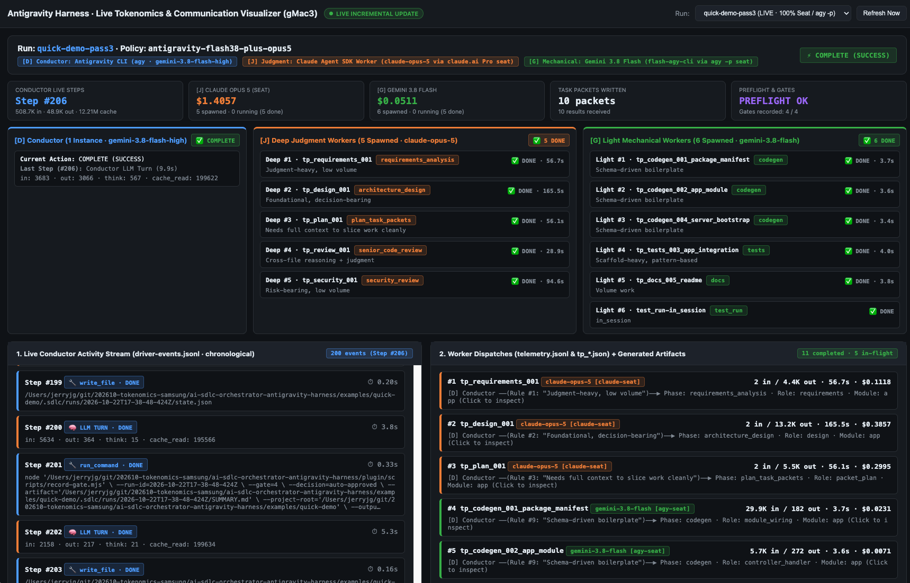
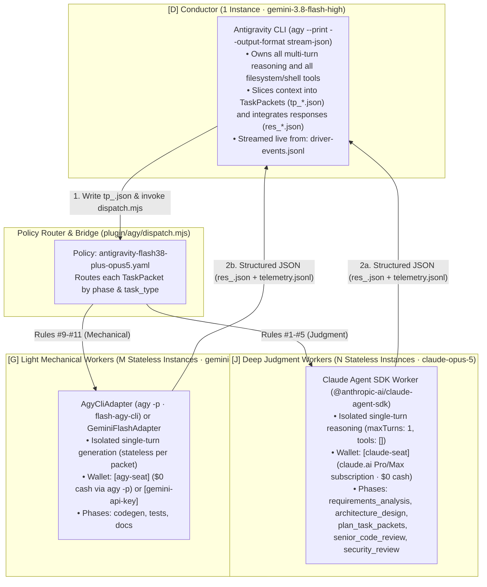

# Live Tokenomics & Communication Visualizer (`tools/dashboard-server.mjs`)



`tools/dashboard-server.mjs` is a zero-dependency, real-time web visualizer for the Antigravity Harness. While a headless or interactive SDLC run is executing, it tails the run directory under `.sdlc/runs/<run_id>/` and renders the live 3-tier multi-model orchestration, token/cache economics, and packet-level communication without resetting your browser scroll position or active tab selection.

---

## 1. Quick Start

Start the visualizer from the repository root:

```bash
node tools/dashboard-server.mjs
```

By default, it listens on **`http://127.0.0.1:8088`** (`http://localhost:8088`) and automatically discovers all run directories under `examples/quick-demo/.sdlc/runs/` (sorted newest-first).

### Optional CLI Flags

| Flag | Default | Description |
| :--- | :--- | :--- |
| `--port=<number>` | `8088` | HTTP port to bind on `127.0.0.1` (can also be set via `PORT` env var). |
| `--project-root=<path>` | `examples/quick-demo` | Path to the project whose `.sdlc/runs/` directory should be monitored. |

---

## 2. 3-Tier Architecture & 100% Subscription Seat Mode (`flash-agy-cli`)

The visualizer highlights the three distinct execution tiers defined by the active routing policy (`antigravity-flash38-plus-opus5.yaml`):



### Why Workers Are Stateless (`1 Packet = 1 Fresh Worker Instance`)
* **No Context Blow-up**: Reusing a worker session across files would accumulate prior file prompts and responses in conversation history (`O(N^2)` token growth) and cross-contaminate file generation. Instead, Phase 3 (`plan_task_packets`, run by `claude-opus-5`) slices the architecture design into file-sized packets (`packets.json`), and each packet spawns a fresh, stateless worker instance carrying only the minimal input slice (`3K–5K` tokens) required for that file.
* **Strict Write-Contract Enforcement**: Workers run with `maxTurns: 1` and `tools: []` (no `Read`, `Write`, `Edit`, or `Bash` access). Only the `[D] Conductor` (`agy`) executes tools and writes files to the workspace.
* **Zero-Cash Mechanical Tier via `AgyCliAdapter` (`flash-agy-cli`)**: In addition to `flash-completion` (REST API via `GEMINI_API_KEY` / Vertex AI), `antigravity-flash38-plus-opus5.yaml` supports `flash-agy-cli` (`AgyCliAdapter.ts`), which dispatches mechanical packets through `agy --print --output-format stream-json` on the user's Antigravity subscription seat (`wallet: "agy-seat"`, `kind: "modeled"`, **`Cash: $0.0000`**).

---

## 3. Visual Guide to the Dashboard Sections

### A. Top Run Banner & 5 KPI Summary Cards
At the top of the screen, the banner shows the active `Run` ID, `Policy` name, the three tier badges (`[D] Conductor`, `[J] Judgment`, `[G] Mechanical`), and the live run status (`⚡ Step #...` while running, or `⚡ COMPLETE (SUCCESS)` when finished).

Below the banner, five KPI cards summarize real-time progress:
1. **`CONDUCTOR LIVE STEPS`**: Current step counter (`Step #206`) and cumulative Conductor token consumption (`508.7K in · 48.9K out · 12.21M cache`).
2. **`[J] CLAUDE OPUS 5 (SEAT)`**: Cumulative modeled cost (`$1.4057`) and instance count (`5 spawned · 0 running (5 done)`).
3. **`[G] GEMINI 3.8 FLASH`**: Cumulative cost (`$0.0511`) and instance count (`6 spawned · 0 running (5 done)`).
4. **`TASK PACKETS WRITTEN`**: Number of `tp_*.json` task packets written by the Conductor vs. `res_*.json` responses received.
5. **`PREFLIGHT & GATES`**: Live preflight verification status (`PREFLIGHT OK`) and SHA-256 phase gate progress (`Gates recorded: 4 / 4`).

---

### B. 3-Tier Live Agent Status Roster (Middle 3-Column Matrix)
Directly below the KPI row is a 3-column live status board showing every agent/worker instance and what it is doing right now:

| Column | What It Displays |
| :--- | :--- |
| **1. `[D] Conductor (1 Instance · gemini-3.8-flash-high)`** | Shows whether the Conductor is `🟢 ACTIVE` or `✅ COMPLETE`, its **Current Action** (`Step #N · <tool_name>`), and the token/duration breakdown of its most recent step. |
| **2. `[J] Deep Judgment Workers (N Spawned · claude-opus-5)`** | Displays all spawned Deep Worker instances (`Deep #1` .. `Deep #5`) at once without nested scrollbars. Any worker currently executing is badged `🟢 RUNNING` and automatically sorted to the top of the list; completed workers show `✅ DONE · <latency>` along with their phase (`requirements_analysis`, `architecture_design`, `plan_task_packets`, `senior_code_review`, `security_review`) and task goal. |
| **3. `[G] Light Mechanical Workers (M Spawned · gemini-3.8-flash)`** | Displays all spawned Light Worker instances (`Light #1` .. `Light #6`) at once, with `🟢 RUNNING` instances sorted to the top. Shows each packet ID (named dynamically by the Phase 3 `claude-opus-5` planner, e.g., `tp_codegen_001_package_manifest`, `tp_codegen_002_app_module`, `tp_tests_003_app_integration`), phase badge (`codegen`, `tests`, `docs`), and completion latency (`3.4s–4.0s`). |

> **Tip**: Clicking any worker chip in either the 3-Tier Roster or the Worker Dispatches list opens the **Task Packet Inspector Modal**.

---

### C. Bottom Left — `1. Live Conductor Activity Stream (driver-events.jsonl · chronological)`
* Visualizes the `[D] Conductor` (`agy`) internal agent loop step-by-step from `driver-events.jsonl`:
  * **`🧠 LLM TURN`**: A `gemini-3.8-flash-high` reasoning turn, displaying exact `in`, `out`, `think`, and `cache_read` tokens.
  * **`🔧 view_file` / `write_file` / `run_command` / `manage_task`**: Every file read, packet write, gate recording, or background task check performed by the Conductor.
  * **`🚀 DISPATCH`**: Every `dispatch.mjs` call handing off a `tp_*.json` packet to an external worker.
* **10-Item Auto-Scrolling Viewport**: Styled as a 10-item scrollbox (`max-height: 680px; overflow-y: auto`) that smoothly auto-scrolls to the bottom whenever a new step arrives so the latest 10 steps remain in view. Between step updates, incremental DOM diffing (`setIfChanged`) leaves the DOM untouched so you can scroll up to inspect earlier steps without being snapped back every 2 seconds.

---

### D. Bottom Right — `2. Worker Dispatches + Generated Artifacts` & Packet Inspector Modal
1. **Worker Dispatches List**:
   * Shows in-flight packets (`⏳ IN-FLIGHT: tp_*.json`) at the top followed by every completed worker dispatch from `telemetry.jsonl`.
   * Each card displays the dispatch number, packet ID, model and wallet badge (`claude-opus-5 [claude-seat]`, `gemini-3.8-flash [agy-seat]`), fresh input vs. output tokens, latency, modeled/cash cost, and the matched policy rule (`Rule #1`, `Rule #9`, etc.).
2. **Interactive `Task Packet Inspector` Modal (Click Any Worker Card)**:
   * Clicking any worker card opens a modal with three full JSON views:
     1. **`1. Telemetry & Policy Routing Receipt`**: Full `telemetry.jsonl` entry including cache-write TTL split, adapter, wallet, and routing rule.
     2. **`2. Conductor ──▶ Worker TaskPacket (tp_<id>.json)`**: The exact instruction, input file slices, acceptance criteria, and JSON `outputSchema` sent to the worker.
     3. **`3. Worker ──▶ Conductor Response (res_<id>.json)`**: The structured JSON payload returned by the worker.
3. **Live Log & Artifact Tabs**:
   * Below the worker list, interactive tabs let you inspect:
     * `📡 orchestrator.log` (live `MMO:` stream: `policy.load`, `route.decide`, `dispatch.start`, `dispatch.end`)
     * `📊 report.txt` (final cost receipt generated by `tools/report.mjs`)
     * `📄 requirements.md`, `📄 design.md`, `📄 packets.json`, `📄 review.json`, `📄 security_review.md`, `📄 SUMMARY.md`
   * Incremental DOM diffing preserves your active tab selection across the 2-second live poll.

---

## 4. Data Sources Read by the Visualizer

All data displayed by `tools/dashboard-server.mjs` is read non-destructively from `<project-root>/.sdlc/runs/<run_id>/`:

| File in `.sdlc/runs/<run_id>/` | Dashboard Component Fed |
| :--- | :--- |
| `driver-events.jsonl` | Conductor model name (`init`), `CONDUCTOR LIVE STEPS` KPI, and `1. Live Conductor Activity Stream`. |
| `orchestrator.log` | Real-time `route.decide`, `dispatch.start` (`🟢 RUNNING`), and `dispatch.end` (`✅ DONE`) status in the 3-Tier Live Agent Status Roster, plus the `📡 orchestrator.log` tab. |
| `tp_*.json` & `res_*.json` | In-flight packet detection, worker task goals, and the 3-pane `Task Packet Inspector` modal. |
| `telemetry.jsonl` | Per-worker token/cache/cost cards in `2. Worker Dispatches` and `[J]` / `[G]` KPI totals. |
| `preflight.json` & `gates.jsonl` | `PREFLIGHT & GATES` KPI card. |
| `manifest.json` & `report.txt` | Policy name and `📊 report.txt` tab. |
| `requirements.md`, `design.md`, `packets.json`, `review.json`, `security_review.md`, `SUMMARY.md` | Generated artifact preview tabs. |
